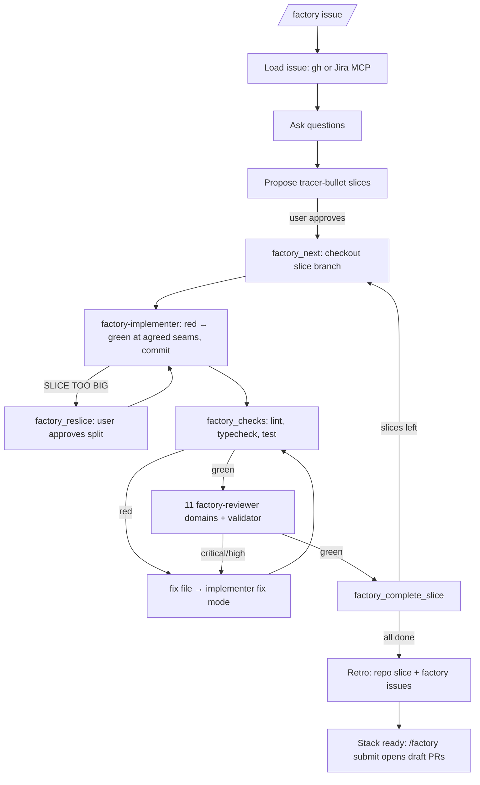

# Software Factory

An [omp](https://github.com/can1357/oh-my-pi) plugin that takes one Jira or GitHub issue to a stack of reviewed
branches. It asks questions, splits the work into tracer-bullet slices that each fit a fresh agent's context
budget, builds each slice test-first, and loops checks → multi-domain review → fixes until the slice is green.
A retro at the end feeds improvements back into the repository and into this plugin.



## How the work is split

| Part | Owner | Why |
| --- | --- | --- |
| Gates: checks, review verdict, round limits, approvals, branch/HEAD checks | TypeScript tools (`src/`) | Deterministic; the model cannot talk its way past them |
| Questions, slicing, deciding what to spawn | Orchestrator (main session) following `skills/software-factory/SKILL.md` | Judgement |
| Implementation and fixes | `factory-implementer` subagent, `tdd` skill autoloaded | Fresh context per slice and per fix |
| Review | 11 `factory-reviewer` subagents (one per cc-pr-review domain) + `factory-review-validator` | Port of `cc-pr-review` onto omp's `task` tool |

User gates: questions at intake, slice-plan approval, seam additions, re-slice approval, stalled fix loops,
retro actions, and `/factory submit`. Nothing opens or merges a PR without the user running `/factory submit`,
and nothing merges at all.

## Install

Prerequisites: `gh` (authenticated), the [`gh-stack`](https://github.com/github/gh-stack) extension for
`/factory submit`, and the Atlassian MCP server for Jira issues. Reviewers and the implementer load these skills
when present: `tdd`, `retro`, `testing-best-practice`, `test-validity-review`, `thermo-nuclear-code-quality-review`.

```sh
git clone git@github.com:adrianbrowning/software-factory.git
cd software-factory && pnpm install --prod
omp plugin link "$PWD"        # or add the path to `extensions:` in ~/.omp/agent/config.yml
```

The package bundles the extension (`src/index.ts`), the skill (`skills/software-factory/`), and the three agents
(`agents/`).

## Use

```text
/factory https://github.com/owner/repo/issues/42
/factory PROJ-123
/factory <pasted issue text>
/factory status
/factory pause
/factory resume <feature>
/factory submit [feature]
```

While a run is active, the session cannot end until the run is done, paused, or stalled. Three stop attempts
without progress pause the run automatically.

## Configure

Optional `.omp/factory.json` in the target repository:

| Key | Default | Meaning |
| --- | --- | --- |
| `checks` | `lint`, `typecheck`, `test` scripts found in `package.json` | Commands run in order; all must pass |
| `checkTimeoutMs` | `600000` | Per-check timeout; the whole process group is killed |
| `maxRounds` | `3` | Fix rounds per slice before the user decides to continue or pause |
| `sliceTokenBudget` | `400000` | Planned context per slice: 40% of a 1M window |
| `baseRef` / `trunk` | `origin/main` / `main` | First slice branches from `baseRef`; the stack is based on `trunk` |
| `branchPrefix` | `factory` | Branches are `<prefix>/<feature>/<NN>-<slug>` |
| `scratchDir` | `.scratch` | Run state; added to `.git/info/exclude` |
| `factoryRepo` | `adrianbrowning/software-factory` | Where retro findings about the factory are filed |

The budget is enforced at planning time (every slice estimate must fit) and measured at run time (peak
implementer context and compactions are recorded per slice for the retro). To keep implementers inside the
budget, compact them at it:

```yaml
# ~/.omp/agent/config.yml
task:
  agentCompactionThresholdOverrides:
    factory-implementer: 400000
```

## Run state

`<scratchDir>/<feature>/` holds `state.json` (schema-validated on every read), `issue.md`, one ticket per slice
under `issues/`, fix files under `fixes/`, review data, per-domain findings, validation and `review.json` under
`reviews/<slice>-r<n>/`, and `retro.md`. Each reviewer writes only its own domain file, so parallel reviewers
never share a write.

The review gate snapshots `HEAD` plus `git status` when a review opens and rejects the review if either changes.
A slice completes only when `HEAD` is still the commit that passed checks and review.

## Develop

```sh
pnpm typecheck
pnpm test
```

`skills/software-factory/references/review/` holds the cc-pr-review domain references from
[`adrianbrowning/agent-skills`](https://github.com/adrianbrowning/agent-skills), adapted to report through
`factory_review_submit`. When the upstream references change, copy them again and re-apply that adaptation
(the "Your role" reporting step and the "Report Format" section).
