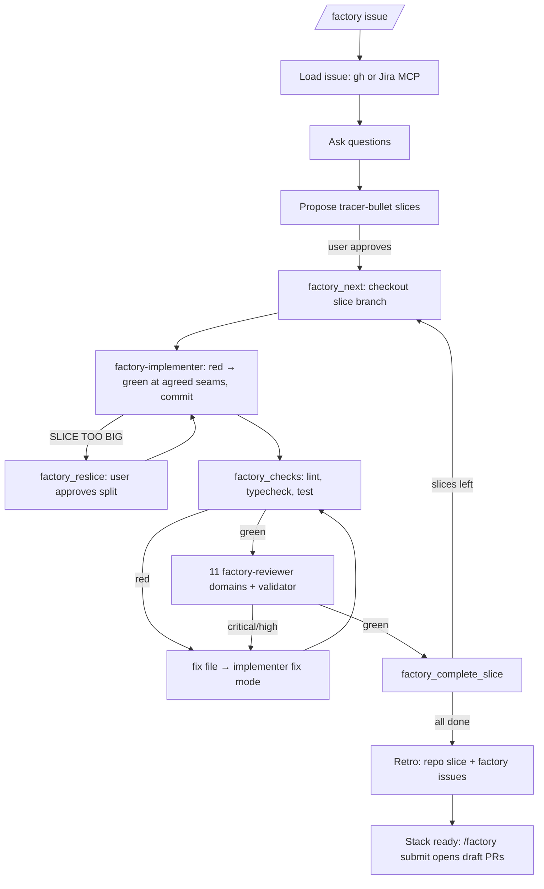

# Software Factory

An [omp](https://github.com/can1357/oh-my-pi) plugin that takes one Jira or GitHub issue to a stack of reviewed
branches. It asks questions, splits the work into tracer-bullet slices that each fit a fresh agent's context
budget, builds each slice test-first, and loops checks → multi-domain review → fixes until the slice is green.
A retro at the end feeds improvements back into the repository and into this plugin.



## How the work is split

| Part | Owner | Why |
| --- | --- | --- |
| Gates: checks, review verdict, round limits, approvals, branch/HEAD checks | TypeScript tools (`src/`) | Deterministic: they decide from git and from what the tools recorded, not from what an agent says |
| Questions, slicing, deciding what to spawn | Orchestrator (main session) following `skills/software-factory/SKILL.md` | Judgement |
| Implementation and fixes | `factory-implementer` subagent, `tdd` skill autoloaded, own advisor (`advisor: true`; override with `task.agentAdvisor.factory-implementer: "off"`) | Fresh context per slice and per fix; the advisor watches the session under the most context pressure |
| Review | 11 `factory-reviewer` subagents (one per cc-pr-review domain) + `factory-review-validator` | Port of `cc-pr-review` onto omp's `task` tool. The validator, with a clean context, keeps a blocking (`critical`/`high`) finding only when it is a gap in correctness or the ticket's requirements. A supported blocking finding that fails that bar (a speculative abstraction, defensive code for an impossible state, a test for a case that cannot happen) is downgraded to an observation, not lost |

User gates: questions at intake, slice-plan approval, seam additions, re-slice approval, stalled fix loops,
retro actions, and `/factory submit`. The plugin opens PRs only when you run `/factory submit`, and it never
merges. A run planned with `landOn` opens no PRs: `/factory submit` fast-forwards that existing local branch to
the top slice, without a checkout or a merge commit.

## Install

Prerequisites: `gh` (authenticated), the [`gh-stack`](https://github.com/github/gh-stack) extension for
`/factory submit`, and the Atlassian MCP server for Jira issues. Reviewers and the implementer load these skills
when present: `tdd`, `retro`, `testing-best-practice`, `test-validity-review`, `thermo-nuclear-code-quality-review`.

```sh
git clone git@github.com:adrianbrowning/software-factory.git
cd software-factory && pnpm install --prod
omp plugin link "$PWD"        # or add the path to `extensions:` in ~/.omp/agent/config.yml
```

The package bundles the extension (`src/index.ts`), the skill (`skills/software-factory/`), and the three agents
(`agents/`).

## Use

```text
/factory https://github.com/owner/repo/issues/42
/factory PROJ-123
/factory <pasted issue text>
/factory status
/factory pause
/factory resume <feature>
/factory submit [feature]
```

While a run is active, the session cannot end until the run is done, paused, or stalled. The third stop attempt in a
row without progress pauses the run instead.

## Configure

Optional `.omp/factory.json` in the target repository. Commit it on the base branch: every gate needs a clean
working tree, and unknown keys are rejected.

| Key | Default | Meaning |
| --- | --- | --- |
| `checks` | `lint`, `typecheck`, `test` scripts found in `package.json` | Commands run in order; all must pass |
| `checkTimeoutMs` | `600000` | Per-check timeout; the whole process group is killed |
| `maxRounds` | `3` | Fix rounds per slice before the user decides to continue or pause |
| `sliceTokenBudget` | `400000` | Planned context per slice: 40% of a 1M window |
| `baseRef` / `trunk` | `origin/main` / `main` | Default base: slice 01 branches from the commit `baseRef` points at when the plan is approved; the stack is based on `trunk`. A run that builds on unmerged work names that branch as `baseRef` in `factory_plan`, and its PRs then target it. The plan event in `state.json` records the pinned base |
| `branchPrefix` | `factory` | Branches are `<prefix>/<feature>/<NN>-<slug>` |
| `scratchDir` | `.scratch` | Run state; added to `.git/info/exclude` |
| `factoryRepo` | `adrianbrowning/software-factory` | Where retro findings about the factory are filed |

The budget is enforced at planning time (every slice estimate must fit) and measured at run time (peak
implementer context and compactions are recorded per slice for the retro). To keep implementers inside the
budget, compact them at it:

```yaml
# ~/.omp/agent/config.yml
task:
  agentCompactionThresholdOverrides:
    factory-implementer: 400000
```

## Run state

`<scratchDir>/<feature>/` holds `state.json` (schema-validated on every read), `issue.md`, one ticket per slice
under `issues/`, fix files under `fixes/`, review data, per-domain findings, validation and `review.json` under
`reviews/<slice>-r<n>/`, and `retro.md`. The review data file lists the ticket, each check's result and duration on
the reviewed commit, the diff, and the changed files. Each reviewer writes only its own domain file, so parallel
reviewers never share a write.

The review gate snapshots `HEAD` plus `git status` when a review opens and rejects the review if either changes.
A slice completes only when `HEAD` is still the commit that passed checks and review, and `/factory submit`
refuses any branch whose tip is not its reviewed commit. With `landOn`, it also refuses while that branch is
checked out in any worktree or when it is no longer an ancestor of the top slice; the ref update is
compare-and-swap.

Checks refuse a slice that holds commits another branch or remote outside the run also holds (a merge, rebase,
or fast-forward onto other work), so the review diff is only the slice's own commits. A backup branch that copies a
slice trips this too; delete it, or keep backups under a name the check ignores (`<prefix>/<feature>/…`).

## Trust boundaries

The gates stop model mistakes and limit what a misled agent can do. They are not a sandbox:

- Reviewers and the validator have read-only tools plus their one submit tool. Each domain submits once, before
  validation, and the tool records a hash of what it wrote; an edited findings or validation file fails the review.
- The implementer has `read`, `write`, `edit`, `grep`, `glob`, `bash`, and `lsp`, and runs on your machine with your
  credentials. Within one omp process, the tools reject a `state.json` changed outside them. After a restart,
  `/factory resume` trusts the file on disk but sends the active slice back through checks and review.
- Issue text and comments are marked as untrusted in `issue.md` and in the review data. The orchestrator asks you
  before it uses text from GitHub users who are not collaborators. Unlike the earlier Sandcastle drop-in, nothing
  runs in a container.

## Develop

```sh
pnpm typecheck
pnpm test
```

`skills/software-factory/references/review/` holds the cc-pr-review domain references from
[`adrianbrowning/agent-skills`](https://github.com/adrianbrowning/agent-skills), adapted to report through
`factory_review_submit`. When the upstream references change, copy them again and re-apply that adaptation
(the "Your role" reporting step and the "Report Format" section).
