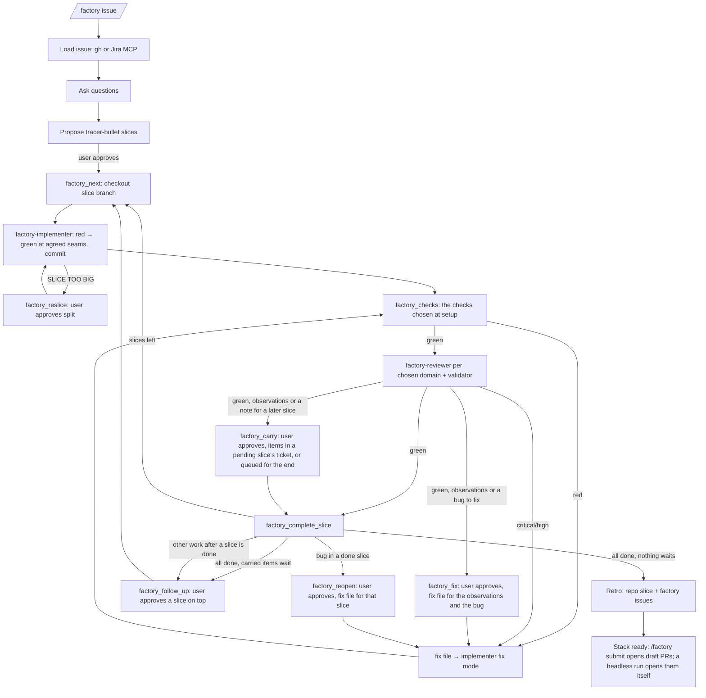

# Software Factory

An [omp](https://github.com/can1357/oh-my-pi) plugin that takes one Jira or GitHub issue to a stack of reviewed
branches. It asks questions, splits the work into tracer-bullet slices that each fit a fresh agent's context
budget, builds each slice test-first, and loops checks → multi-domain review → fixes until the slice is green.
A retro at the end feeds improvements back into the repository and into this plugin.



## How the work is split

| Part | Owner | Why |
| --- | --- | --- |
| Gates: checks, review verdict, round limits, approvals, branch/HEAD checks | TypeScript tools (`src/`) | Deterministic: they decide from git and from what the tools recorded, not from what an agent says |
| Questions, slicing, deciding what to spawn | Orchestrator (main session) following `skills/software-factory/SKILL.md` | Judgement |
| Implementation and fixes | `factory-implementer` subagent, `tdd` skill autoloaded, own advisor (`advisor: true`; override with `task.agentAdvisor.factory-implementer: "off"`) | Fresh context per slice and per fix; the advisor watches the session under the most context pressure, and the ticket file ends with a note that asks the advisor to check each change it proposes against the ticket's acceptance criteria and decisions. The implementer submits its final report (commits, checks, fix file items, behaviors, open; one line per item, `checks` one `<command> → exit <code>` line per check command it ran (its last run), stored under `Checks:` and not verified by the factory, fix file items required in fix mode, and in build mode only `<carried key> fixed in <sha>` lines on a slice with carried keys; each behavior is a test, the behavior it proves, and `seenRed` with a one-line `red` for the failing run the implementer observed, or `seenRed: false` without `red`) with `factory_implementer_report`, and again after every follow-up turn. The factory keeps the latest report per slice in `reports/<slice>.md`, the file the `factory_next` reply names, where the orchestrator reads it without running checks. The `factory_checks` reply shows it after the `Slice commits` list (and in its no-commits and foreign-commits refusals), or says that none was submitted, and names the file, so a follow-up turn such as an advisor note cannot lose it. Spawning a new implementer (a fix round, or a respawn after a stop report) and re-slicing clear the report, so each implementer shows only its own. After a restack the factory first rewrites its commit shas to the rebased commits (paired by position and subject). At a reopen or restack restart a report is kept only when it has at least one Commits item and each names a current own commit of the slice, and is removed otherwise (for example for a slice branch the user rebased by hand, or when the rebased commits cannot be paired); In build mode the tool refuses (and stores nothing) a report for a slice with seams that lists no behavior or, for a slice without a `noTestReason`, whose commits change no test file or whose behaviors all have seenRed false (to see a test red honestly: revert the production change for that test, run it, watch it fail, restore the change, and report the failing run), unless Open names a stop report (NEEDS SEAM, SLICE TOO BIG, MISSING DEPENDENCY); a slice with seams and a `noTestReason` is exempt from the changed-test-file rule and the seen-red rule, and still needs one behavior; messaging an implementer keeps it |
| Review | Up to 11 `factory-reviewer` subagents (one per cc-pr-review domain) + `factory-review-validator` | Port of `cc-pr-review` onto omp's eval `agent()` helper: the orchestrator runs every reviewer, waits for all of them, then runs the validator, in one eval cell. The factory skips `react-ts`, `test-validity`, and `devops` when no changed path could hold their subject (the orchestrator can keep one back); the orchestrator skips other domains the diff gives nothing to review, each with a reason; `bug` and `scope` always review, and `testing` does too for a slice with test seams. The validator, with a clean context, keeps a blocking (`critical`/`high`) finding only when it is a gap in correctness or the ticket's requirements. A supported blocking finding that fails that bar (a speculative abstraction, defensive code for an impossible state, a test for a case that cannot happen) is downgraded to an observation, not lost. A finding that shows the code breaks a recorded decision blocks: the reviewer cites the decision number and the validator downgrades it only with `decisionMatch` (why the code matches the decision), and the validator escalates an observation that shows such a conflict (`decision`) or an unmet acceptance criterion read literally (`criterion`) to `high`. The tools enforce cited decisions only; an uncited conflict depends on the reviewer and validator seeing it |

User gates: questions at intake, slice-plan approval, seam additions, re-slice approval, stalled fix loops, fixing
observations of a green review, reopening a done slice, retro actions, and `/factory submit`. The plugin opens PRs
when you run `/factory submit`, and a headless run opens draft PRs itself when the stack is done (below), and it never
merges: merging stays manual. Every PR body is written from run state: the issue link, the slice summary, the checks run,
the review rounds, the autonomous decisions, the accepted-unresolved findings, and the deferred items with their sink locations.
A headless run opens its draft PRs when it becomes ready, and the reply names the PR URLs. When a headless run pauses on red
checks, the done slices below the red one are submitted as draft PRs whose bodies say the stack stopped at that slice and
why; the red slice is not submitted. `headless.submission: "stop"` keeps a headless run from submitting: the run keeps its status; once it is done, `/factory submit` opens the PRs, and a run paused on red checks needs `/factory resume` to finish the stack first.
`/factory submit` sets each slice PR title to `<feature>: NN <slice title>`, overwriting a title edited by hand.
A run planned with `landOn` opens no PRs: `/factory submit`
fast-forwards that existing local branch to the top slice, without a checkout or a merge commit.
While `/factory submit` runs, it shows each step as a notification and in the status line, for example the
`gh stack submit` push, which can take a few minutes.
A second `/factory submit`, for example after a follow-up slice, adds the new slice branches to the existing gh stack
with `gh stack add` and submits again. For a run without `--base` it refuses, and changes nothing, when that stack holds
branches outside the run or holds the run's branches in another order; the error names those branches.
A headless run started with `--base <branch>` adopts no new stack: its first submit adds the slice branches with
`gh stack add` on top of the gh stack whose top branch is that base branch, and only the run's own PRs get the factory
title and body. That first submit refuses, and changes nothing, when the base branch is in no gh stack or is not the top
of its stack. Its re-submit instead accepts the stack whose branches below slice 01 end with the base branch (the base
branch need not be the top of anything then) and adds only the missing slice branches. It refuses, and changes nothing,
when the branches below slice 01 do not end with the base branch or hold a run branch, or when the stack holds
other branches outside the run or the run's branches in another order.

## Install

A fresh install needs the tools and skills below, then the plugin. The plugin bundles its own extension
(`src/index.ts`), orchestrator skill (`skills/software-factory/`), and three agents (`agents/`), but not the skills
its agents load.

### Tools

| Tool | When | Install |
| --- | --- | --- |
| [omp](https://omp.sh) | Always | Homebrew: `brew install can1357/tap/omp`; other systems: see [omp.sh](https://omp.sh) |
| Node.js 24 or later (`engines`: `>=24`) | Always: runs the plugin's TypeScript directly | [nodejs.org](https://nodejs.org) or your version manager |
| pnpm 10 | Always: installs the plugin's dependencies | `corepack enable` (the repo pins the version in `packageManager`) |
| `gh`, authenticated | GitHub issues, and filing retro findings on the factory repo | `brew install gh && gh auth login` |
| [`gh-stack`](https://github.com/github/gh-stack) | Only for `/factory submit` and a headless run's own submission, which open PRs; not for `landOn` runs | `gh extension install github/gh-stack` |
| Atlassian MCP server | Only for Jira issues | Add it to omp's MCP servers |

`npx` in the skill commands below comes with Node.js.

### Skills

| Skill | Used by | Source |
| --- | --- | --- |
| `tdd` | `factory-implementer` (autoloaded) | `mattpocock/skills` |
| `retro` | Orchestrator, retro step | `mattpocock/skills` |
| `testing-best-practice` | testing reviewer | `adrianbrowning/agent-skills` |
| `test-validity-review` | test-validity reviewer | `adrianbrowning/agent-skills` |
| `thermo-nuclear-code-quality-review` | thermo reviewer | `adrianbrowning/agent-skills` |

```sh
npx skills add mattpocock/skills -g -s tdd
npx skills add mattpocock/skills -g -s retro
npx skills add adrianbrowning/agent-skills -g -s testing-best-practice
npx skills add adrianbrowning/agent-skills -g -s test-validity-review
npx skills add adrianbrowning/agent-skills -g -s thermo-nuclear-code-quality-review
```

The agents load these skills when present. A run without them still works, but its reviews and retro are weaker.
`retro` and `test-validity-review` set `disable-model-invocation: true`, so they do not appear in the session's
skill list; the factory reads them by `skill://` URL, which still works.

### Plugin

```sh
git clone git@github.com:adrianbrowning/software-factory.git
cd software-factory && pnpm install --prod
omp plugin link "$PWD"        # or add the path to `extensions:` in ~/.omp/agent/config.yml
```

Start a new omp session after you install or update. The link points at the clone, so `git pull` updates the plugin.

## Use

```text
/factory https://github.com/owner/repo/issues/42
/factory PROJ-123
/factory <pasted issue text>
/factory status
/factory pause
/factory checks
/factory resume <feature>
/factory submit [feature]
```

The first run in a repository asks which check commands every slice must pass. The editor has the `lint`,
`typecheck`, and `test` scripts on their own lines (they run), and other suggestions as `#` comments (remove the `#`
to run one):

- other `package.json` scripts that look like checks, such as `build`, `check:*`, `e2e`, or `verify`;
- `run:` commands from `.github/workflows`, except installs, commands a script already covers, and multi-line
  scripts with `cd`, `export`, or control flow.

When there are no suggestions, the editor tells the user to type the commands. If the user submits the editor
empty, it opens again. If the user cancels it, `factory_start` fails.

The factory saves the choice in the scratch dir, and later runs use it with no dialog. To change it, run
`/factory checks`: new runs use the new list, and a run that already started keeps its checks. To share one list
with the whole team, set `checks` in `.omp/factory.json` instead; then the factory does not ask.

While a run is active, the session cannot end until the run is done, paused, or stalled. The third stop attempt in a
row without progress pauses the run instead. In an interactive run, a stop whose latest tool call is the omp `ask`
tool is allowed and clears the stop-attempt count, so waiting on an answer never auto-pauses the run. Headless runs get
no such exemption: their stops are still blocked, then paused. When the latest assistant message ended with a provider
error (`stopReason` `error`), the pause names that error, redacted, as its cause instead of no progress.

When a slice uses up its fix budget (from red checks, a blocking review, `factory_fix` with a bug after a green review, or `factory_reopen`; a `factory_fix` round for observations only does not count, and neither does a bug added to a red review's fix file with `bug-f<round>-<n>`), a dialog asks whether to
continue with `maxRounds` more fix rounds or pause. A paused stall leaves the run stalled, and the tool reply and its
`Next:` line say so. `/factory resume <feature>` on a stalled run names the slice and its used rounds and asks
whether to raise the fix budget by `maxRounds` and resume; declining keeps the run stalled.
Resume also checks out the active slice's branch when another branch is checked out and the working tree is clean, and
the reply says so. With a dirty tree or a failed switch it leaves the checkout and the reply names the mismatch: commit
or remove the changes and check out the slice branch before the next factory tool.
Resume also moves a running run's active slice from implement to checks when its branch has own commits, the stored
implementer report lists every one in Commits, and Open names no stop report; it records a resume event.
Resume also moves a running run's active slice in a fix round to checks when its round commits (after the fix file's commit) are all in the stored report's Commits and Open names no stop report.
Resume also copies the latest pause cause, redacted, once into the open fix file of an active slice in fix, as a `## Pause cause` section; it adds no fix item.

### Headless runs

`/factory headless <issue>` starts a run that asks the user nothing: every gate follows the `headless.*` policy in
`.omp/factory.json` (default `auto`, each choice recorded as a run event), and the factory opens draft PRs when the stack is
ready. Run it without a TUI through `omp -p`:

```text
omp -p --wait-async --no-extensions -e <plugin dir> --max-cost 25 --max-time 5400 "/factory headless #102"
```

- `--wait-async`: without it `omp -p` exits and cancels the background subagents.
- `--no-extensions -e <plugin dir>`: loads only this plugin, from the checkout you name.
- `--max-cost <usd>` and `--max-time <seconds>`: the only cost and time limits of a headless run. `--max-time` exits 1,
  `--max-cost` exits 3; the run state stays on disk and `/factory resume <feature>` continues it.
- `/factory headless` in the TUI has no cost cap and no time limit.

`/factory headless <issue> --related <ref>,<ref>` covers related issues in the same run: a comma-separated list of issue
numbers, `#numbers` or issue URLs (at most 20), given after the primary issue. The run is still named after the primary
issue. It needs a GitHub primary issue, not an issue file.

```text
/factory headless 294 --related 260,#285,https://github.com/o/r/issues/209
```

`/factory headless <issue> --base <branch>` builds the run on an existing local branch (as `git branch` lists it; a remote
ref such as `origin/x`, a missing branch or any other revision is refused at start, before a run is created). The run pins
the branch's commit at start and records the branch as `baseBranch`: slice 01 branches from that commit, also when the
branch moves later, while the PRs still target the configured trunk, not the base branch. `--base` and `--related` can be
given together in either order after the issue. A headless run's base is fixed at start, so `factory_plan` refuses
`baseRef`, `landOn` and `trunk` in it; a run started without `--base` plans on the configured base.
The headless start message names the base (the configured base, or the `--base` branch at its pinned sha) and the branch the PRs target, and warns when the base is neither the configured base nor the PR target.

```text
/factory headless 294 --base issue-293-top-slice --related 260
```

`/factory headless <issue> --max-rounds <n>` sets the run's fix rounds per slice to a positive whole number `n`. Without
it the run takes `headlessMaxRounds` from `.omp/factory.json`. The run keeps this value from its start: every slice it
plans, reslices or appends gets it, also after the config changes, and `/factory resume` keeps it. It can be given with
`--base` and `--related` in any order after the issue.

Run it from a worktree of the repository, with checks configured (a headless start refuses a repository with no checks).
The issue-text, planning, stop-report, observation and retro rules of a headless run are in `skills/software-factory/SKILL.md`.

To work through a backlog, `scripts/headless-backlog.sh <issue> [<issue> ...]` runs one headless run per issue, one
after the other, in the current worktree, chained into one stack of draft PRs: the first run starts without `--base`,
and each later new run starts with `--base <top slice branch of the run before it>` (the last slice in that run's
state.json), so its PRs stack on the run before. A listed issue whose run is already done with a submit is skipped, and
its top branch is the base of the next run. A run that is not done is resumed (`/factory resume`, which takes no
`--base`) only if check (3) below passes first, so a paused run that started on another base never submits onto the
wrong stack. Before a done run (one the script just finished or one it skips) becomes the base of the next run, the
script checks it, in this order: (1) its last submission event is a submit and each slice branch has an open or merged
PR (`gh pr list --head <branch> --state all`; a failing `gh` call fails the check with its message); (2) its top slice
branch, on origin (`git ls-remote origin`) and locally (the next run's `--base` pins the local branch), is still at the
top slice's green commit; (3) its recorded `baseBranch` is the top slice branch of the run before it in the list, and is
absent for the first, whose recorded `baseRef` must also be the configured default base (`baseRef` in .omp/factory.json,
else the branch `origin/HEAD` points at, else `origin/main`). A skipped run and a resumed middle run are checked the
same way, so a rerun continues past a resumed run only when it passes. The batch stops at the first failed check, or at
the first run that does not end done with a submit (paused, stalled, failed, running, or done with no PRs, a failed
submission or `headless.submission: "stop"`; `/factory submit` opens those PRs), names the run (and the check) in the
summary and exits 1, with no later issue started. The batch also stops at a listed ref that is not an issue number or
GitHub issue URL, and at a done, submitted run with no slice branch to stack the next run on. Running the script again
continues the backlog. Give `--separate` as the first argument, before the issue refs, to keep one stack per run: no run
gets `--base`, no chain check runs (and `gh` is not needed), each plans on the configured base (by default origin's
default branch, as last fetched) and opens its own stack of draft PRs, a bad ref is skipped, and a run that fails or
pauses does not stop the next one; only a run that omp leaves `running` (at `--max-time` or `--max-cost`) stops the
batch, because it blocks every new run in the worktree. The script prints each run's status and PR URLs, and the reason
of each paused run, and exits 1 when any issue did not end with a done run whose PRs are open. Set `OMP` (default
`,omp`), `OMP_ARGS` (extra omp flags, split on spaces, for example `--advisor`), `PLUGIN_DIR` (default the installed
plugin), `MAX_COST` (default 25), `MAX_TIME` (default 5400) and `MAX_ROUNDS` (unset by default; when set, each new run
gets `--max-rounds $MAX_ROUNDS`, and a resumed run keeps the value it started with; a value that is not a positive whole
number of at most 15 digits exits 2 before any run); the logs go to `<git dir>/headless-backlog/`. Set these
in the environment instead of editing the script: the script's test runs the working-tree copy. The script is safe to
run from the worktree that the runs use, also when a run checks out a branch that changes `scripts/headless-backlog.sh`:
the shell has read the whole script before the first run starts.

### Land on an existing branch

Use this when you want the work on a branch that you already have, and you do not want new PRs. At intake, tell
the orchestrator, for example: "Put this on my branch `EXT2-953-closeOrReload`. Do not open PRs." It passes that
branch to `factory_plan` as `landOn`.

- Give the branch name as `git branch` lists it. The plan refuses `origin/…`, `refs/heads/…`, revision expressions
  such as `main^{commit}`, and branches that do not exist.
- The branch is also the base, unless you pick a different base. Then the branch must be at or below that base.
- The plan dialog shows `/factory submit fast-forwards <branch> to the top slice; no PRs`.
- The factory still builds and reviews each slice on its own `<prefix>/<feature>/<NN>-<slug>` branch.

When the run is done, run `/factory submit` and confirm `Fast-forward <branch>?`. The factory moves your branch to
the reviewed commit of the top slice. It does not check out, merge, or push. It refuses, and changes nothing, when:

- a slice branch moved after its review;
- your branch is checked out in a worktree (switch that worktree to a different branch first);
- your branch is gone, or has commits that are not in the stack.

Then push your branch. You can delete the slice branches.

### Fix observations or a bug before a slice is done

After a red review the next review is targeted (unless a bug was added to that red review's fix file with `factory_fix`, below, which makes it a full review): the factory runs only the domains that blocked, plus bug, scope and (with seams) testing, and reviewers report observations only on the lines the fix changed. A green targeted review is followed by a full review of the same commit, and `factory_complete_slice` refuses until the last green review is a full one (an observation-only `factory_fix` round after a full green needs only its own targeted review). A bug fix round always needs a full review.

A green review can list non-blocking observations. When you want some of them fixed in the active slice, the
orchestrator asks you which. When you find a bug in the active slice after its green review, tell the orchestrator.
`factory_fix` (the observation ids, the bug as free text in `bug`, or both, and your `reason`) opens a dialog that
shows them. A bug is written in full to a file under `confirmed/` before the dialog opens, and the dialog's last line
names that file with its line and character counts. After you confirm:

- The slice gets a fix file with those observations and a "Bug found after green review" section for the bug, and
  goes back to fix. The green review is dropped, so the slice goes through checks and a new review again before
  `factory_complete_slice`.
- A round with a bug counts in the slice's fix rounds (`factory_status`) and against its round limit; a used-up
  budget stalls like any other fix round. A round for observations only does not count and never stalls the slice.
- It refuses a call with neither a bug nor observation ids, an id that is not an observation of that green review,
  and a slice without a green review. The ids may be observations of any review of the active slice, red ones
  too (the slice's unplaced list). A slice cannot complete with an unplaced observation, so a done slice has none to
  fix; a bug in a slice that is already done goes through `factory_reopen`.

After a red review, before the fix-mode implementer commits, `factory_fix` with only `bug` and `reason` (a bug no
reviewer submitted, for example one an advisor found) adds the bug to the fix file the red review wrote: one more item
`bug-f<round>-<n>` under `## Fix items` (`<n>` counts from 1) plus its own section with the reason and the redacted
bug. No new fix file is written, no fix round is counted, and the slice never stalls from it. The next review is a
full review, and its scope reviewer gives the item a verdict like any fix item; an open verdict blocks. In that state
`factory_fix` refuses observation ids (with or without a bug), refuses a bug once HEAD is past the commit the fix
file describes (the implementer has committed), and refuses a bug while the slice is stalled (fix budget used up),
with the same stall notice the other slice tools give; each refusal comes before any dialog, names its reason and
changes neither the fix file nor the run. The `factory_review_record` reply for a red review that stalled the slice
leaves out the `factory_fix` bug hint. Each added bug's section heading is
`## Bug added after red review <review>: <id>`, matching its line under `## Fix items`.

### Carry observations into a later slice

When a green review lists observations that belong in a later slice, or you want extra work built there, the
orchestrator asks you where they go. `factory_carry` (observation ids from the active slice's green review, a
free-text `note`, or both, and `to`: the id of a pending slice, or `"end"`) opens a dialog that shows them. A note is
written in full to a file under `confirmed/` before the dialog opens, and the dialog's last line names that file with
its line and character counts. After you confirm:

- With a slice id, the items are added to that slice's ticket under "Carried-in work". Its implementer builds them,
  and its review data file lists them, so its reviewers check them.
- With `"end"`, the items wait on the run, and no slice changes. `factory_status` lists them under `waiting`. Once
  every existing slice is done, the next action is `factory_follow_up`: the slice it adds takes every waiting item into its
  ticket under "Carried-in work", and the queue empties. `factory_retro` refuses while items wait, and a run with
  waiting items is not ready to submit.
- The active slice keeps its green review, and `factory_complete_slice` completes it without new checks or review
  once none of its observations is unplaced.
- A re-slice keeps the items: the first child takes those of the split slice.
- It refuses a call with neither observation ids nor a note, an id that is not an observation of that green review,
  an id its green review does not list, a slice without a green review, and a
  target that is neither `"end"` nor a pending slice.

### Place observations in one batch (`factory_place`)

Every observation a reviewer reports has a category: correctness, missing-test, misleading-doc, naming, structure or
style; `factory_review_submit` refuses an observation without one. The slice collects the kept observations of all its
reviews, red ones too. The reply of the slice's final full green review lists them with their default placement:
correctness to the end queue, misleading-doc and missing-test to fix in this slice (an observation-only fix round that uses no fix budget; once the slice has an observation placed as fixed, they fall back to the end queue; correctness on a follow-up slice built from end-queue items defaults to the same fix, then falls back to the sink or leave), naming, structure and style to leave. `factory_place`
takes the exceptions (fix, carry to a pending slice, end, defer, leave; `placements: []` takes every default), asks one
confirm in an interactive run, applies them all and records each in the ledger. `factory_complete_slice` refuses while
the slice has an unplaced observation. A headless run places the defaults with no dialog when it completes the slice, starts the observation-only fix round for the fix defaults (the slice stays active in fix and the reply names the fix file; when the slice was accepted unresolved, its blocking findings of category misleading-doc join that round and its fix file, and do not start it on their own),
and sends the leave items to the deferred sink when one is set. The observations of a follow-up slice built from end-queue
items (headless or interactive) and of a Record deferred items slice do not default back to the end queue: their end-category
defaults become defer to the sink when the slice may defer to it (a Record slice may not), else leave, and the user can
still choose end in `factory_place`.

### Leave observations, and the observation ledger

The run keeps one ledger of every observation it has handled: carried (`factory_carry`), deferred (`factory_defer`),
fixed (`factory_fix`) or left (`factory_leave`). Each entry holds the review id and observation id (its key, for
example `01-r1:thermo-naming`), the finding's location, title and problem, and the placement. `factory_status` lists
it under `observations`.

`factory_leave` (observation ids from the active slice's green review, after its full review) records them as left:
no slice builds them and no sink gets them. An interactive
run asks once; a declined dialog records nothing, and a headless run records with no dialog. `factory_carry`,
`factory_defer` and `factory_leave` refuse observation ids until the slice's last green review is a full one; a
note-only carry or defer works at any green review.

- All four tools refuse an observation the ledger already holds and name its placement (`Observations already
  carried: ...`), before any dialog.
- The review data file of every review has a `## KNOWN OBSERVATIONS` section that lists the ledger entries with key,
  placement, location, title and problem. Reviewers leave out a problem that matches an entry by location and problem,
  and the validator drops a repeat under a new id with the reason `same as <key>`. A left observation is never raised
  again in the run. An entry carried to the slice under review is marked `carried to this slice: check it` in that review's data
  file: the slice builds it and its reviewers check it, so a finding that it is unbuilt or wrong is not a repeat and the
  validator keeps it. An entry carried to the end queue is marked in the review of the `factory_follow_up` slice that takes it; a re-slice keeps the mark on the renumbered slice. Entries carried to other slices stay plain `carried`.
- A run saved before the ledger loads its carried and deferred observations as ledger entries, with the location,
  title and problem read from the finding that the carried-in section of a ticket or the end queue, or the deferred
  item's body, rendered. When that text is not found, or more than one carried-in section holds it, the entry gets a
  placeholder location (`unknown`) and problem, and is still refused by key. A key both carried and deferred is one
  entry, carried.

### Reopen a done slice

When the orchestrator finds a bug in a slice that is done, it asks you. When you agree, `factory_reopen` (slice id
and the bug as `reason`) opens a dialog. After you confirm, the fix goes into that slice, so its PR does not keep the
bug:

- The working tree must be clean, the run must be running or done, and the slice must be done. One slice at a time
  can be reopened.
- The active slice goes back to pending. Its branch keeps its commits.
- The reopened slice gets a fix file with the bug and goes through fix, checks, and review again. The fix round counts
  against its round limit.
- When the reopened slice is complete again, the factory rebases every later slice branch onto the fix, bottom up. Completing any slice does the same for the existing later slice branches whose parent moved since they were cut, not only a reopened slice.
  Each branch keeps only its own commits on top of its parent. Backup refs `refs/factory/<feature>/backup/<NN>` hold
  the old tips until every rebase passes. Each later slice goes back to pending and starts again at checks.
- If a rebase conflicts, the factory aborts it, puts every later branch back at its old tip, and pauses the run. The
  error names the branch. Resolve it, then run `/factory resume <feature>`.
- A done run runs again, and it needs a new retro before `/factory submit`.
- Commits on the slice branch after its green review are listed in the fix file. They are part of the fix round, so
  they get checks and a full review. This is how to keep a commit made on a done slice: `/factory submit` refuses a
  branch that moved after its review.

### Add a follow-up slice

For other work found after a slice is done, for example a non-blocking review observation you want fixed, the
orchestrator asks you where it goes: into that slice (`factory_reopen`), or into a new slice on top of the stack.
`factory_follow_up` (title, what to build, acceptance, seams or `noTestReason`, estimate) opens a dialog. After you
confirm:

- The new slice comes last and branches from the slice below it. The other slices and their PRs are not changed.
- It goes through implement, checks, and review like any other slice, and gets its own PR.
- It takes every item waiting on the run from `factory_carry` with `to: "end"`, and the queue empties.
- The dialog and reply list each waiting item whose file its own slice changed, as a warning that a later `factory_reopen` of that slice can conflict when the follow-up slice restacks onto it.
- A done run runs again, and it needs a new retro before `/factory submit`.

## Configure

Optional `.omp/factory.json` in the target repository. Commit it on the base branch: every gate needs a clean
working tree, and unknown keys are rejected.

`factory_checks` reruns each failed check command once, as a whole command. A rerun that passes counts as passed: the summary marks the check flaky with the first failure's exit code and duration and names the failing tests of that first run (node:test `✖ failing tests:` entries with file:line, TAP `not ok` lines; redacted, at most 10 and a count of the rest; with no test named, the last non-empty line of the stream that received non-blank output last instead, naming the stream), and no fix file or fix round is used; a flaky check's first attempt output is kept when the checks pass (a run that ends failed keeps none), in `checks/<slice id>-f<N>-check<K>-attempt1.log` in the run dir (N: the slice's fix file count, K: the check's position), which the `factory_checks` reply names under `First attempt output of flaky checks:` and the `## CHECKS` section of the review data file lists. A rerun that fails goes into the fix file and counts as a fix round. A timed-out check is not rerun, and a command-not-found check is refused as an environment error without a rerun. A check that ends failed or timed out while the host clock jumped (a host sleep or clock change of more than 30 s during its deciding run) is refused as an environment error with no fix file and no fix round, and `factory_checks` is called again.

| Key | Default | Meaning |
| --- | --- | --- |
| `checks` | Asked on the first run | Check commands every slice must pass, in order. `factory_checks` runs them in full on the slice's commits; the implementer runs only the typecheck, the test files it touched, and the test files that assert on output it changed, and the test files the repository names for its kind of change. Unset: the first `factory_start` in the repository opens a dialog with the `lint`, `typecheck`, `test` scripts chosen, and other check-like `package.json` scripts and `.github/workflows` `run:` commands as commented suggestions. The choice is saved in `scratchDir`, and later runs reuse it with no dialog. `/factory checks` changes it for new runs; a run keeps the checks it started with |
| `checkPath` | `[]` | Directories put before the omp process `PATH` when checks run. Each entry is an absolute path or starts with `~/`. Use it when a check command is not found (exit 127), for example `["~/Library/pnpm/bin"]`. Find the directory with `command -v <tool>` in your terminal |
| `checkTimeoutMs` | `600000` | Per-check timeout; the whole process group is killed |
| `maxRounds` | `3` | Fix rounds per slice before the user decides to continue or pause; each continue, and each yes to the `/factory resume` question on a stalled run, adds this many |
| `headlessMaxRounds` | `3` | Fix rounds per slice in a headless run (`/factory headless`), unless `--max-rounds` sets them. The run keeps the value from its start. A headless run never raises them: when a slice uses them up, its open items go on record as accepted-unresolved, or the run pauses when its checks are red |
| `headless.<gate>` | `auto` | Headless runs only (`/factory headless`); interactive runs never read it. One key per gate: `resume`, `plan`, `reslice`, `decide`, `seams`, `fix`, `carry`, `reopen`, `followUp`, `retro`, `checks`, `submission`. `auto` proceeds and, for the gates other than `checks` and `submission` (which keep their own one-line event text), records an `autonomous` run event naming the gate and holding the dialog title and body (redacted, the first 2,000 characters; the `followUp` event keeps the whole overlap block of `factory_follow_up`, however long, and clips only the follow-up's free text); `stop` pauses the run with a reason naming the gate and throws (except `submission`: `stop` opens no PRs and leaves the run with its status, see the paragraph on `headless.submission` above; `auto` opens draft PRs through `gh stack`) (`checks` has no run yet, so it refuses the start). The orchestrator can pause a headless run itself with `factory_pause`. Text from issue authors outside the repository is always left out of a headless run, and a headless start without configured checks saves the detected ones, else refuses. |
| `deferred` | unset | Where `factory_defer` sends green-review observations and notes, and where a headless run's accepted-unresolved findings go by themselves: `{ "kind": "file", "path": "docs/factory-deferred.md" }` (path optional; items queue on the run for the file to be written) or `{ "kind": "github" }` (one `gh issue create` per item, the issue URL stored). Each item names the run, slice and review id (an item filed from a finding also names the finding's symbol first, the path:line marked as the location at filing time, and the commit the review was made on, noting that its ids, paths and line numbers are as of that commit; a note names only run, slice and review), and `factory_status` lists them with their locations. An interactive run asks the user before `factory_defer` files or queues anything (a headless run does not ask). Ids the observation ledger already holds (carried, deferred, fixed or left) are refused. With no sink, `factory_defer` is refused and accepted-unresolved findings stay on the slice and in its event. |
| `sliceTokenBudget` | `400000` | Planned context per slice: 40% of a 1M window |
| `baseRef` / `trunk` | `origin/HEAD`'s branch, else `origin/main` / `main` | Default base: slice 01 branches from the commit `baseRef` points at when the plan is approved (a headless run started with `--base` pins it at start). Unset, it is the remote default branch that `origin/HEAD` points at (`origin/master` in a repository whose trunk is master), else `origin/main`. The stack is based on `trunk`, which defaults to `baseRef` without its git remote (`origin/main` → `main`; a local `feature/auth` stays `feature/auth`). A run that builds on unmerged work names that branch as `baseRef` in `factory_plan`, and its PRs then target it. The plan event in `state.json` records the pinned base |
| `branchPrefix` | `factory` | Branches are `<prefix>/<feature>/<NN>-<slug>` |
| `scratchDir` | `.scratch` | Run state; added to `.git/info/exclude` |
| `factoryRepo` | `adrianbrowning/software-factory` | Where retro findings about the factory are filed |
| `models` | `{}` | Model per factory role, see [Role models](#role-models) |

The budget is enforced at planning time (every slice estimate must fit) and measured at run time (peak
implementer context and compactions are recorded per slice for the retro). To keep implementers inside the
budget, compact them at it:

```yaml
# ~/.omp/agent/config.yml
task:
  agentCompactionThresholdOverrides:
    factory-implementer: 400000
```

### Role models

`models` sets the model per factory role. A role without an entry inherits: omp's own choice (agent model overrides,
agent frontmatter, then the parent model) stands, and the factory returns no model for it.

| Role | Routes |
| --- | --- |
| `orchestrator` | Nothing; you choose its model at omp launch, and `factory_start` checks it |
| `implementer` | `factory-implementer` spawns |
| `reviewer` | `factory-reviewer` spawns, for every review domain |
| `validator` | `factory-review-validator` spawns |
| `explorer` | spawns of any agent named `scout` while a run in the repository is in intake or running; none outside a run or while it is paused, stalled or done |

One `reviewer` model covers every domain. Per-domain reviewer models are not supported: omp's spawn event does not
carry the review domain, so the factory cannot tell the reviewers apart. Only spawns from the main session are routed:
an agent a subagent spawns inherits. Routing changes only the model; no agent's tools or gates change.

The `explorer` role matches by name only: omp's spawn event does not say where an agent was defined, so a project,
user or plugin agent named `scout`, which replaces omp's bundled `scout`, is routed too.

```json
{
  "models": {
    "implementer": {
      "model": "anthropic/claude-sonnet-4-5",
      "fallbacks": ["openai/gpt-5.2"]
    }
  }
}
```

- `model` is an exact `provider/id` or an `@role` alias, resolved like omp's `--model`. `fallbacks` is an optional
  list of more patterns omp tries in order. It is the only fallback the factory allows.
- `factory_start` resolves every configured model and fallback in the omp session. One that does not resolve stops
  the start with an error that names the role, for example `models.implementer`.
- The run keeps the mapping it started with, as it keeps its checks. `factory_start` and `factory_status` show it per
  role (`inherit` for a role with no entry). Editing `.omp/factory.json` or resuming does not change a running run:
  spawn routing, the agent audit, implementer context tracking, the stop gate, `/factory status` and `pause`, and every
  factory tool except `factory_start` find the run through the workspace it started or resumed with and never reread
  `.omp/factory.json`, so an invalid edit, new models or a new `scratchDir` leave them as they were when the run
  started or resumed. `factory_start` writes that workspace and the active feature to
  `software-factory-active-run.json` in the checkout's git dir (`git rev-parse --git-dir`, so each worktree has its
  own), outside `scratchDir`. omp runs some subagents on worker threads when four or more run at once, each with its
  own copy of the extension; every copy resolves the run from that file, so `factory_review_submit`,
  `factory_review_validate`, `factory_implementer_report` and the hooks work there too.
- Every routed spawn of the run (for the implementer: build, fix, reopened, and follow-up slices) gets its role's
  model and fallbacks. When the model no longer resolves, the spawn is refused with a reason that names the role.
  When the run state cannot be read, a factory-role spawn is refused the same way and a `scout` spawn goes
  unrouted. The factory does not switch to another model.
- `reasoningEffort` (`minimal`, `low`, `medium`, `high`, `xhigh`, `max`) is accepted only for `orchestrator`, whose
  model and effort you choose at omp launch (`--model`, `--thinking`). omp gives the factory no way to set a
  subagent's reasoning effort: a real omp spawn ignored an effort suffix on the model. A `reasoningEffort` on
  `implementer`, `reviewer`, `validator` or `explorer` fails validation with an error that names the role.
- The orchestrator is the omp session you run `/factory` in, so choose its model when you launch omp, for example
  `omp --model anthropic/claude-opus-4-5 --thinking high`. With a `models.orchestrator` entry, `factory_start` and
  `factory_start` resume (against the run's snapshot) compare the live session model with it, and the thinking level
  too when `reasoningEffort` is set. On a mismatch they stop with an error that names `models.orchestrator`, the
  configured and the live selection, and the `--model`/`--thinking` flags to relaunch with. The factory never switches
  the session model. Without an `orchestrator` entry nothing is checked.
- Each factory child (`factory-implementer`, `factory-reviewer`, `factory-review-validator`, spawned by `task` or
  eval `agent()`) and each `scout` records, from inside its own session when its first turn ends, the model and
  thinking level omp actually runs it on, with its session id, agent id, name and role. A child that omp ran on a
  configured fallback is recorded with the fallback. omp's spawn event names no child, so the record states what
  actually ran, not whether the spawn hook routed it; compare it with the run's snapshot model in `factory_status` to
  see a mismatch. A child is recorded when the main session that started or resumed the run spawned it and its first
  turn ends while this omp process remembers the run, whatever the run's status: a scout spawned while the run is
  paused, or a child whose first turn ends after the run is done, is recorded too. A child whose first turn ended
  before the run started, or outside any run or git repo, is not recorded. Each session is recorded once, checked
  against the run's stored records by session id.
  `factory_status` lists the records under each slice's `agents`, and those from when no slice was active (such as an
  intake scout) under `agentsOutsideSlices`.

## Run state

`<scratchDir>/<feature>/` holds `state.json` (schema-validated on every read), `checks/` (the first attempt output of flaky checks, `checks/<slice id>-f<N>-check<K>-attempt1.log`, which the `factory_checks` reply names and the `## CHECKS` section of the data file lists), `issue.md`, one ticket per slice
under `issues/`, fix files under `fixes/`, the latest implementer report per slice under `reports/<slice>.md` (with a factory-written `Factory-observed typecheck:` section after `Checks:`: the last unfiltered run of each typecheck command of the run's checks that the factory saw in the implementer's bash calls, or a line saying it saw none), review
data, per-domain findings, validation and `review.json` under
`reviews/<slice>-r<n>/`, `confirmed/` (the exact redacted note or bug text each `factory_carry` or `factory_fix` dialog shows, one file per distinct text), and `retro.md`. Each fix file lists its fix items under `## Fix items`: review findings by id,
and factory-assigned ids for a bug (`bug-f<N>`, or `bug-f<N>-<n>` for a bug added to a red review's fix file), a reopen reason (`reopen-f<N>`), a failed check (`check-f<N>-<k>`),
and a working tree the checks changed (`tree-f<N>`). The section of a comments-domain finding ends with a sibling-comment note: search `src/`, `README.md`, `agents/` and `skills/` for key words of the fact the comment states and fix every other comment the diff makes false for it in the same round. The section of a bug-domain finding ends with a documented-behavior note: if the fix changes behavior that prose states, search `src/`, `README.md`, `agents/` and `skills/` for key words of the changed behavior and fix every doc comment and README, agent or skill statement the fix makes false in the same round. The review data file lists the ticket, then a `## LATER SLICES`
section with each not-done slice stacked after the reviewed one, in stack order (id, title, what to build, acceptance
criteria), or says none follows; reviewers and the validator do not count work a later slice lists as a gap in this
slice. Then come each check's result and duration on the reviewed commit, a `## KNOWN OBSERVATIONS` section with the observation ledger (None when empty), a `## FIX ITEMS` section with every fix item
from the fix rounds since the last recorded review (id, fix file and round, summary; None when there are none), a `## IMPLEMENTER BEHAVIORS` section with the Behaviors (test, behavior, seen-red mark) of the slice's latest stored implementer report as untrusted claims (or a line saying no report was stored; commits, fix items, checks, the factory-observed typecheck section and open items stay out), the
diff, and the changed files. A decision can name the slice that builds it (`factory_decide` item `{ text, slice }`, or
`ownsDecisions` on a `factory_plan` slice); that slice's state keeps the decision numbers it owns, and the tickets and
review data of the slices before it mark the decision as built by that slice, so their reviewers report only code
that contradicts it.
The scope reviewer gives each fix item a verdict in `fixItems` of its `factory_review_submit` call: `fixed`,
`not-a-defect` (with evidence from the diff or code), `waived` (with a recorded decision number), or `open`, each with
a reason. The tool refuses a scope submission that misses an id, names an unknown one, repeats one, or cites a
decision that does not exist. Recording a review stores the verdicts in `review.json` and clears the gathered fix
items, except open ones: an open item makes the review `CHANGES_REQUESTED` even with no blocking finding, goes into the
next fix file (which then names it as asked in that round), and carries into the next review's `## FIX ITEMS`.
Each reviewer writes only its own domain file, so parallel reviewers never share a write. The submit tool rejects a
finding whose `path` the diff does not change, or whose `line` is outside that file's new-side hunks; the review data file's `## CHANGED FILES` section lists those ranges per file.

`state.json` records the state schema version and the `factoryVersion` that saved it. Version 1 files still load and
are saved as version 2. A file with a newer state version, written by a newer factory, is refused with a message naming the writer's factory version, the
state version and this factory's version.

The review gate snapshots `HEAD` plus `git status` when a review opens and rejects the review if either changes.
A slice completes only when `HEAD` is still the commit that passed checks and review, and `/factory submit`
refuses any branch whose tip is not its reviewed commit. With `landOn`, it also refuses while that branch is
checked out in any worktree or when it is no longer an ancestor of the top slice; the ref update is
compare-and-swap.

Checks refuse a slice that holds commits another branch or remote outside the run also holds (a merge, rebase,
or fast-forward onto other work), so the review diff is only the slice's own commits. A backup branch that copies a
slice trips this too; delete it, or keep backups under a name the check ignores (`<prefix>/<feature>/…`).

In a fix round, checks also refuse when a commit made since the fix file is missing from the Commits section of the
stored implementer report (or no report is stored). The refusal lists those commits, does not count a fix round, and
asks you to message the implementer to resubmit its report with `factory_implementer_report`. The refusal also holds
after a resume moved the fix round to checks, and after a passed fix round's checks were invalidated (HEAD moved, repository changed), for a commit made after that.

In a fix round the checks reply also lists the ids of the current fix file that the Fix file items of the stored
implementer report do not account for, without refusing, counting a fix round or rerunning checks.

## Trust boundaries

The gates stop model mistakes and limit what a misled agent can do. They are not a sandbox:

- Reviewers and the validator have read-only tools plus their one submit tool. Each domain reviewer may replace its
  submission any number of times until validation; the validator may replace its validation once, until the review is
  recorded. The tool records a hash of what each wrote; an edited findings or validation file fails the review.
- The implementer has `read`, `write`, `edit`, `grep`, `glob`, `bash`, and `lsp`, plus `factory_implementer_report` for
  its final report, and runs on your machine with your credentials. The tools reject a `state.json` changed outside
  them: a `state.json.saved` file beside it records the hashes of the last saves, so every thread and process that
  loads the extension sees it. The file sits in the run directory, so the implementer's tools can edit or delete it: the check catches accidental edits to `state.json`, not a deliberate bypass. A `state.json.lock` file serializes their updates. After a restart, `/factory resume` trusts the file on disk: the active slice keeps
  its passed checks and green review only while HEAD is still the commit they recorded and the run's check commands
  are the ones that passed, and an open review stays open with its recorded submissions while HEAD and the repository snapshot are unchanged, and is discarded (review-invalidated event) when the snapshot changed, the review's `data.md` is missing, or a recorded domain or validation file is missing or edited. `/factory checks` on that same commit reuses the stored
  results instead of running the checks again.
- Issue text and comments are marked as untrusted in `issue.md` and in the review data. `factory_start` loads GitHub
  issues itself with `gh` and asks you before the run uses the title, text, or comments of GitHub users who are not
  collaborators, in one dialog for the primary issue and every related one. Unlike the earlier Sandcastle drop-in, nothing runs in a container.
- A run can cover several GitHub issues: `factory_start` takes `source: { kind: "github", ref, related: ["126", ...] }`.
  `ref` is the primary issue; its title, ref and URL stay the run's. The related issues' text and comments follow it in
  the run's issue body, and `issue.md` and `factory_status` list each related issue; `issue.md` shows each GitHub issue's filing time.
  `related` takes at most 20 refs. A related issue from a repo other than the run's working repo is outside text in full,
  whatever its author's association there (shown in the one dialog; headless leaves it out); the primary issue keeps the
  normal trust rule.

## Develop

```sh
pnpm typecheck
pnpm test
pnpm run lint
pnpm run test test/units.test.ts   # only the named test files
```

`skills/software-factory/references/review/` holds the cc-pr-review domain references from
[`adrianbrowning/agent-skills`](https://github.com/adrianbrowning/agent-skills), adapted to report through
`factory_review_submit`. When the upstream references change, copy them again and re-apply that adaptation
(the "Your role" reporting step and the "Report Format" section).
